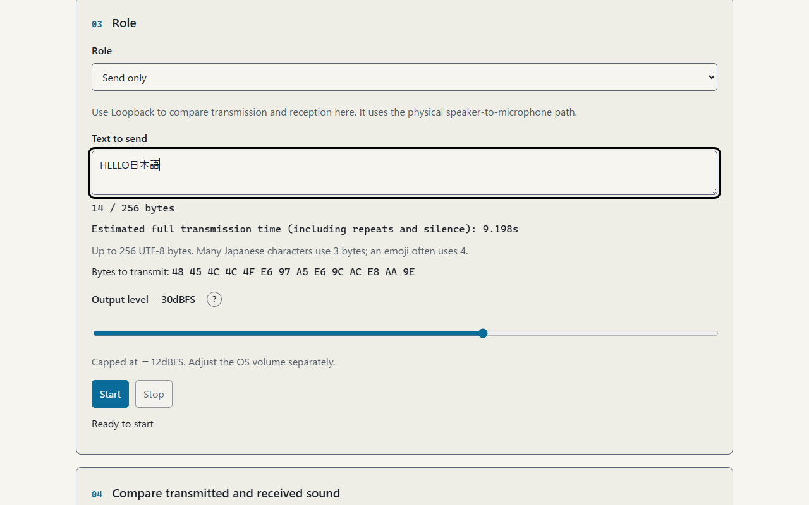
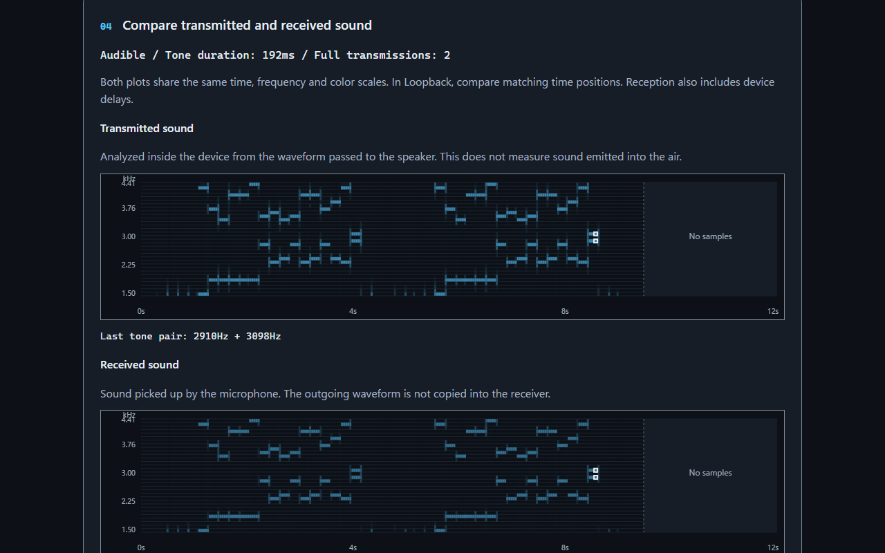
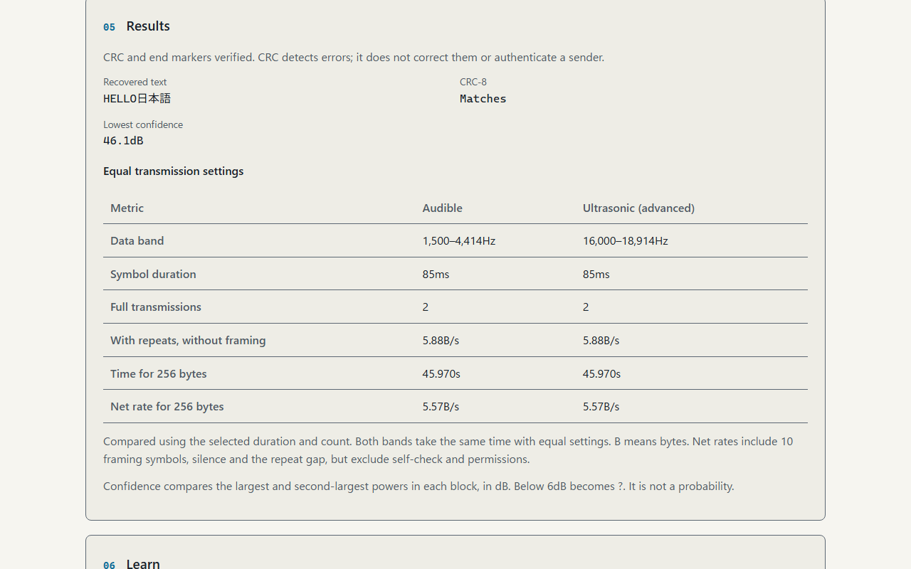
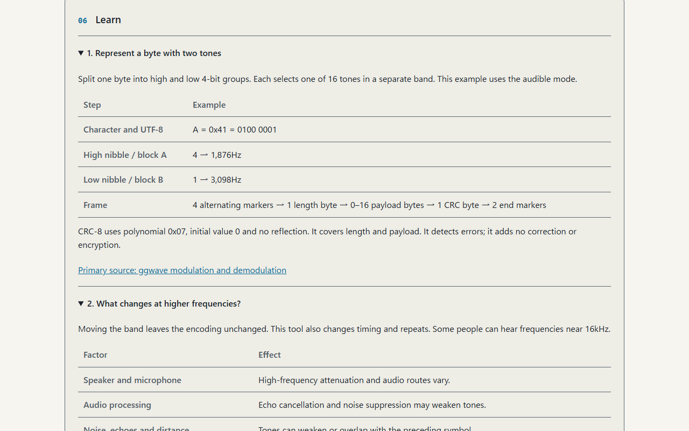

# Airborne Tone Link - Send short text through sound and visualize the channel


[](https://ipusiron.github.io/airborne-tone-link/)

**Day120 - 200 Security Tools Created with Generative AI**

Airborne Tone Link is an educational tool that sends short text from a speaker to a microphone and displays the channel as a spectrogram.
Watch text become UTF-8 bytes, pairs of tones and decoded characters in audible and near-ultrasonic modes.
It does not encrypt messages. Anyone who knows the protocol and can receive the tones can decode them.

[日本語](README.md) / English

## 🌐 Demo

👉 **[Open Airborne Tone Link](https://ipusiron.github.io/airborne-tone-link/)**

No installation is needed. You can also download the files together and open `index.html` directly.
Microphone access requires browser permission. Public HTTPS or localhost is recommended; microphone access on `file://` varies between browsers.

## 📸 Screenshots

> 
>
> *“HELLO日本語” occupies 14 UTF-8 bytes.*

> 
>
> *Outgoing waveform above, microphone input below, with shared axes. This screenshot uses a test-only virtual path.*

> 
>
> *A locally decoded WAV, with CRC, confidence and the time needed for 256 bytes.*

> 
>
> *The two frequencies for “A”. The learning section contains five topics.*

The four Japanese views appear in the [Japanese README](README.md).

## ✨ Features

- Split one byte into two 4-bit groups; select one tone from each of two separate 16-tone blocks
- Audible and Ultrasonic bands with independent common settings: 85/192/384ms tones and 1/2 full transmissions
- Send only, receive only, physical loopback and local WAV decoding
- A spectrogram focused on 32 data tones, with incremental UTF-8 decoding
- CRC-8, confidence and character agreement for loopback
- Reported microphone processing settings, Japanese/English, light/dark themes and keyboard controls

## 📖 Usage

### Send between two devices

First, use Check device names near the top to identify the opened microphone input and the default output reported by the browser. Test microphone shows input levels for five seconds without playing sound. Test speaker plays one 1kHz, 0.4-second tone at −30dBFS without opening the microphone. Stop, Help, hiding the tab and leaving the page end the tests.

Reported names do not identify microphones or speakers connected beyond an audio interface. Withheld names remain unconfirmed. Levels are not sound pressure, and the page cannot determine whether you actually heard a test tone. Device names and audio are neither saved nor sent over the network.

1. Open the tool on both devices and select the same band and tone duration. Begin with Audible.
2. On the receiving device, select Receive only, start and allow microphone access.
3. On the sending device, select Send only and enter up to 256 UTF-8 bytes.
4. Lower the OS volume, then start. Check the receiver's text and CRC.
5. To try near-ultrasound, switch both devices to Ultrasonic.

`HELLO` is 5 bytes, `日本語` is 9 bytes and `😀😀😀😀` is 16 bytes.
The small question-mark button beside Output level explains the effect of changing the value and its relationship to OS volume. The input area shows the estimated full transmission time. At 256 bytes, defaults take about 103 seconds; Extra long with two transmissions takes about 205 seconds. Keep both pages in the foreground while transmitting and receiving.

Defaults are Audible, Long (192ms), and two full transmissions. Changing bands preserves duration and count. Some people can hear frequencies near 16kHz.
Avoid simultaneous transmitters. There is no automatic reply or retransmission request; switch roles to reverse the direction.

### Loop back on one device

Loopback uses the physical speaker-to-microphone path.
A short 1kHz self-check must rise at least 10dB above background before transmission starts.
Headphones may prevent the microphone from receiving the self-check.
If echo cancellation or noise suppression is on, the tool asks whether to continue. It displays reported settings, not requested values.

### Decode a WAV

Select Decode a WAV and load audio using this tool's frame format.
Supported files are PCM 16/24/32-bit or float 32-bit WAV, 8–96kHz, one or two channels, at most 128MiB and 300 seconds (5 minutes).
The selected band must be supported at the file's sample rate. Compressed WAV and WAVE_FORMAT_EXTENSIBLE are not supported.
Stereo channels are averaged, so opposite-phase audio can cancel out. Other modem protocols and speech are not decoded.

### Recovered text and successful reception

“Text recovered from sound” contains candidates read from the microphone in Receive or Loopback, the outgoing waveform in Send, or the selected WAV offline. The send text is never copied into this display. Partial text is unverified; CRC, end-marker and UTF-8 verification is reported separately.

If no payload byte is readable, the display says “No characters recovered.” A `?` marks an unreadable position, not an acquired character (unless the original text contains a `?`). Readable and unreadable byte counts are shown separately. Stopping preserves partial candidates as unverified; changing the mode or role clears previous results.

The graph spans 12 seconds. The selected duration and count determine how much unmeasured time remains on the right. Both bands take the same time with equal settings. “No samples” does not mean measured silence or reception failure. A frame that could not be read to the end may still contain partial candidates.

Offline decoding creates neither microphone input nor audio output. The file stays local; its selection and analysis data are released when decoding finishes or stops.
The tool has no recording or audio-download feature.

### Compare transmitted and received sound

If text recovery fails, check Reception diagnostics. It shows data tone detection, marker types, start sequences, length bytes, readable payload, frame verification and the largest analysis interval for that run. Stages not reached are not treated as successful, and readable bytes are not combined across repeats. The failed stage remains visible after stopping. Visible tones alone do not establish successful text communication.

The default Loopback role shows the outgoing waveform above and microphone input below. Separate analyzers measure the two paths on the same time, frequency and color scales. The output is never wired directly into the receiver. The upper plot measures the digital waveform passed to the speaker, not sound emitted into the air. Their difference is not a calibrated attenuation measurement.

To compare frequency bands, keep duration, count, message, volume and device positions equal. With default Long tones and two transmissions, `HELLO` takes 5.742 seconds in either band. Reception delays also appear on the shared time axis.

Send only measures the upper plot; Receive only measures the lower plot. Check the transmitting device for its own outgoing waveform. WAV data appears below. Select the duration used by the sender when receiving or decoding WAVs. Older audible WAVs use Long (192ms). The count is a sender setting; Receive only stops at the first valid frame.

## 🎯 Use cases

### Uses specific to this tool

| Question | Action and example |
|---|---|
| Does character count equal communication size? | `HELLO` has 5 characters and 5 bytes; `日本語` has 3 characters and 9 bytes. Compare their transmission times |
| What happens when a character repeats? | `AAAA` repeats 1,876Hz and 3,098Hz. A synchronized clock still reads four separate bytes |
| Which missing tone prevents decoding? | Change device direction or distance and inspect both blocks. One block alone leaves four bits unknown, producing “?” |
| What does a speed figure count? | With defaults, either band takes 102.894 seconds for 256 bytes, or 2.49B/s net. Compare with 2.60B/s excluding framing |
| Is communication the same as secrecy? | Decode a public message with another receiver. CRC success does not imply encryption or sender authentication |

In a class or exhibit, explain the mechanism in audible mode before moving to near-ultrasound.
A WAV with the same frame format lets you inspect decoding independently of the room and physical device path.

## 🔬 Protocol and decisions

| Item | Value |
|---|---|
| Encoding and limit | UTF-8, 256 bytes |
| Tones | High nibble in block A, low nibble in block B; 32 candidates total |
| Tone spacing | 94Hz, approximately four bins at 48kHz with FFT 2048 |
| Data-band span | 2,914Hz across 31 intervals; markers at F0−188Hz and F0−94Hz |
| Frame | 4 alternating markers, 1 or 3 length bytes, 0–256 payload bytes, 1 CRC byte, 2 end markers |
| CRC | CRC-8/SMBUS: polynomial 0x07, initial value 0, no reflection, final XOR 0; covers length and payload |
| FFT | 2048 samples, Blackman window, no smoothing; maximum power within ±1 bin of each candidate |
| Confidence | Ratio between the largest and second-largest candidate powers; both blocks must reach 6dB; display the lower value |
| Output | Calculated sine-wave AudioBuffer, 6ms edge ramps, default −30dBFS, maximum −12dBFS |

Lengths up to 254 use one byte. For 255 or 256 bytes, `FF` introduces a two-byte big-endian length: `FF 00 FF` or `FF 01 00`. CRC covers the entire wire length header and payload. Keep messages within 16 bytes when communicating with an older version; update both sender and receiver for longer messages.

For `HELLO`, payload bytes are `48 45 4C 4C 4F`, length is `05` and CRC is `B8`.
`A` (`41`) maps to 1,876Hz and 3,098Hz in audible mode.
After the preamble, the decoder uses a fixed symbol clock, including for identical consecutive bytes.
Markers sit below the data band and are not among the 32 spectrogram rows.

Spectrogram shading represents relative FFT power from −100 to −20dB, not sound pressure.
Outlines also identify the last recognized tone pair. The plot covers the latest 12 seconds.
Reduced-motion preferences limit painting to four times per second without changing demodulation timing.
Multibyte UTF-8 characters appear once their required bytes arrive.

CRC detects errors without correcting them. The decoder also validates end markers and UTF-8.
Confidence is not a probability, and CRC cannot prove integrity or sender identity.
Loopback agreement compares Unicode code points at equal positions, using the longer character count as the denominator.
Receive only, WAV decoding and Send only do not display agreement because they lack an independent expected message.

### Values confirmed with OfflineAudioContext

We checked 72 conditions in Chromium and Firefox at 44.1/48kHz.
Eight amplitude checks covered 34 frequencies with an independent sine/cosine least-squares fit; the maximum deviation from −30dBFS was below 0.000001dB.
Sixty-four decoding checks combined 44.1/48kHz transmit and receive rates, both bands, 85/192ms durations and both counts, using native resampling and an independent FFT to recover `HELLO日本語` and its CRC.
An additional 32 decoding checks confirmed 384ms tones with the same transmit/receive rates, both bands and 1/2 transmissions.
These measurements support F0=1,500/16,000Hz, 94Hz spacing and common 85/192/384ms symbols with 1/2 transmissions.
They validate software waveforms, not physical high-frequency response or transmission distance.

## ⏱️ Transfer-rate limits

Comparison with default Long (192ms) tones and two full transmissions. Frequency band and timing are independent.

| Item | Audible | Ultrasonic (advanced) |
|---|---:|---:|
| F0 | 1,500Hz | 16,000Hz |
| Data band | 1,500–4,414Hz | 16,000–18,914Hz |
| Symbol duration | 192ms | 192ms |
| Full transmissions | 2 | 2 |
| With repeats, without framing | 2.60B/s | 2.60B/s |
| Time for 256 bytes | 102.894s | 102.894s |
| Net rate for 256 bytes | 2.49B/s | 2.49B/s |

| Common settings | With repeats, without framing | Time for 256 bytes | Net rate for 256 bytes |
|---|---:|---:|---:|
| Short 85ms, once | 11.76B/s | 23.110s | 11.08B/s |
| Short 85ms, twice | 5.88B/s | 45.970s | 5.57B/s |
| Long 192ms, once | 5.21B/s | 51.572s | 4.96B/s |
| Long 192ms, twice (default) | 2.60B/s | 102.894s | 2.49B/s |
| Extra long 384ms, once | 2.60B/s | 102.644s | 2.49B/s |
| Extra long 384ms, twice | 1.30B/s | 205.038s | 1.25B/s |

B means bytes. The rate including repeats but excluding framing is `1 / (symbol duration × transmission count)`.
For payload length L, overhead H, symbol duration T and transmission count R, waveform duration is `0.5 + (L + H) × T × R + 0.25 × (R − 1)` seconds. H is 8 for L up to 254, and 10 for 255 or 256.
This includes 250ms leading/trailing silence and a 250ms repeat gap. Permission time, self-check and device/OS latency are excluded.
Treating “about 2.5B/s” or “about 12B/s” as complete-frame throughput overstates the result.

This implementation leaves enough time for a stable 2048-sample window, about 42.7ms at 48kHz, and uses 94Hz spacing to separate candidates.
Shorter symbols are more sensitive to echoes and scheduling delays; wider tone spacing uses more bandwidth.
Background noise, high-frequency attenuation, microphone processing and device variation reduce reception margin.
Higher frequencies alone do not make the protocol faster.

[The ggwave author's documentation](https://github.com/ggerganov/ggwave#details) reports 8–16B/s.
ggwave uses six simultaneous tones for three bytes and Reed–Solomon error correction.
This tool uses two simultaneous tones for one byte and CRC only; the protocols are incompatible.
It implements the processing in classic scripts without compiled ggwave/quiet components, preserving the restrictive CSP and `file://` operation.

## 🔊 Environmental noise and reception

Whether a person can hear a noise does not determine its effect on reception.
Components reaching the microphone at the frequencies and times used for communication can interfere with the two tones or the start sequence.
The data bands are 1,500–4,414Hz for audible mode and 16,000–18,914Hz for near-ultrasonic mode.
Start/end markers use 1,312/1,406Hz and 15,812/15,906Hz respectively.
Interference with the markers can prevent reception even when the data band is quiet.

“Inaudible noise” is not a synonym for white noise.
**White noise** describes equal power in equal-width frequency bands. Real equipment has finite bandwidth; sufficient audible-band content can be heard as hiss.
Low-frequency sound describes frequency, not whiteness. Japan's Ministry of the Environment uses approximately 1–100Hz, with 1–20Hz classified as infrasound.
Also distinguish quiet sounds, high-pitched sounds that a person cannot readily hear, and electrical noise in the input circuit.
See [NI's noise explanation](https://download.ni.com/support/manuals/370192c.pdf) and [the Ministry's low-frequency sound guide](https://www.env.go.jp/content/900405790.pdf).

The table describes possible effects inferred from sound characteristics and this decoder's design. It is not a measurement of each source or a device-specific success-rate table.
Operating state, distance, placement and input gain can change the result for the same equipment.

| Example source | Relevant characteristics | Effect on audible mode | Effect on near-ultrasonic mode |
|---|---|---|---|
| High-pitched noise from peripherals, power supplies or displays | Tonal components such as coil whine; not necessarily white noise | Components overlapping the communication band can interfere with particular tone candidates | Components around 16–19kHz can interfere even when a person cannot readily hear them |
| Speaker hiss, microphone or input-circuit noise | Broadband acoustic noise versus electrical input noise that does not travel through air | In-band noise can reduce the power difference between candidates | Similar if the noise actually extends into this band; audible hiss alone does not reveal its high-frequency level |
| Refrigerator, outdoor HVAC unit or ventilation hum | Low-frequency compressor/fan components, vibration and harmonics | Pure low-frequency components are outside the band; harmonics or rattling can still overlap it | Little direct overlap from pure low frequencies; input overload and device processing are separate issues |
| Air-conditioner or fan airflow | Continuous broadband components, including air blowing directly on the microphone | Overlapping airflow noise can reduce reception margin throughout a transmission | Depends on high-frequency content and direct airflow; low-frequency dominance does not prove zero effect |
| Keyboard typing | Short impacts, desk vibration and repeated keystrokes | An overlapping impact can disrupt payload or marker decisions | Impacts with sufficient high-frequency content can interfere; this mode is not always better |
| Mouse clicks | Brief impacts that may occur close to the microphone | Even one click can cause an erasure or wrong decision if it overlaps the decision window | Depends on high-frequency content and distance; brevity alone does not make it negligible |
| Video, music or notification playback | A mixture of speech, effects and music; waveforms mix when sharing an output device | Overlapping content can interfere during playback | Depends on high-frequency content and output distortion; video audio is not necessarily free of these components |
| Household conversation, dishes, doors or running water | A mixture of sustained and sudden sounds | Spectral overlap or an impact during a decision window can interfere | Low-frequency speech components alone have little direct overlap; high-frequency dish sounds need separate consideration |
| Outdoor vehicle engines and road noise | Low-frequency engine components plus tire and other noise | The in-band components remaining after attenuation by distance/windows matter | Low hum alone has little direct overlap; broadband components and input overload can still matter |
| Intercoms, bells or alarms | Sustained pitches, harmonics and abrupt onsets | Overlap with a tone or marker can disrupt several successive bytes | Even a low fundamental may have harmonics or onset energy in the communication band |

The [Ministry's source examples](https://www.env.go.jp/content/900405791.pdf) include low-frequency equipment noise, but an equipment name alone does not establish its spectrum.
Even out-of-band sound can change the communication waveform if the microphone/input circuit overloads or automatic gain/noise suppression responds.
The tool requests these processing options off and displays reported settings; it cannot control every process inside the equipment.

For comparison, keep the devices, placement, message and output level fixed. Compare a quiet baseline with one type of everyday sound present.
Check whether the failure occurs at synchronization, length, payload or CRC.
The graph enlarges only the data band; absence of low-frequency sound or out-of-band markers from that graph does not mean those signals are absent.
Passing the 1kHz self-check does not establish reception or noise tolerance across the communication band.

### Short versus long tones

A character appearing to be “cut out” does not necessarily mean that sound was physically removed.
Noise can mask tones, favor a wrong candidate or disrupt synchronization, producing an unknown byte or a wrong byte.
Japanese characters and emoji use multiple UTF-8 bytes, so losing one byte can prevent a complete character from being displayed.

With 85ms symbols, the 2048-sample analysis window, about 42.7ms at 48kHz, occupies a larger share of each symbol.
A click or echo of the same duration can therefore consume more of the usable stable interval.
192ms or 384ms symbols allow more time to average FFT observations near the center, without changing the FFT's frequency resolution.
Longer tones do not remove persistent in-band interference, high-frequency attenuation or clipping. Longer messages also leave more time for another everyday sound to occur.

## 🧩 From partial reception to error correction

### Exact recovery versus understanding the meaning

Sound arriving, some bytes being read, a whole frame passing verification, and a person understanding the message are different outcomes.
In the illustrative received text `MEET AT THE STA?ION`, surrounding letters and vocabulary suggest `STATION` as a candidate.
Grammar, familiar phrases and context provide linguistic redundancy, so a message can remain understandable despite missing characters.
This relates to language redundancy and noisy communication discussed in [Shannon's paper](https://people.math.harvard.edu/~ctm/home/text/others/shannon/entropy/entropy.pdf).

However, a missing digit in `MEET AT 1?`, a negation, an amount or a proper name can change the meaning.
A plausible sentence need not be the original sentence. Compressed data and ciphertext also offer little support for human contextual reconstruction.
**This tool does not implement grammar- or meaning-based candidate reconstruction.** It does not fill “?” automatically or label guessed characters as verified.
Successful reception requires one frame's payload, CRC, end markers and UTF-8 to pass together. CRC-8 can miss some errors; it is neither a mathematical proof of correctness nor sender authentication.

### Benefits and limits of two full transmissions

When a sudden noise overlaps only one copy, the other copy may arrive intact.
The tool validates each copy as a separate frame and uses a valid frame when one is available.
It does not automatically merge partial copies, vote on individual bytes or request retransmission.
Two disagreeing values alone would not give a simple majority vote a correct answer either.

If each copy has the same whole-message success probability `p` and failures are independent, the probability of at least one success in two copies is `1 − (1 − p)²`.
This is an explanatory model, not a measured success rate for this tool.
Persistent interference or attenuation at particular frequencies can damage the same positions in both copies, violating independence.
Repetition also takes more time. A transmission count alone cannot justify filling in characters when none were received.

### Telegraphy and possible future extensions

Recognizing signals and boundaries in noise, then requesting an uncertain portion again, is also a problem in Morse telegraphy.
[ITU's International Morse code](https://www.itu.int/rec/R-REC-M.1677-1-200910-I) defines error and repetition-request signals.
This tool's two copies are scheduled by the sender in advance, unlike retransmission prompted by a receiver request.
Neither Morse code itself nor human contextual guessing should simply be treated as an error-correcting code.

**Error-correcting codes** add structured redundancy to recover original data within specified error or erasure limits.
A future error-correction option could improve reception when some bytes cannot be read.
The following are unimplemented design options, not features added by this documentation change.

| Possible extension | Expected benefit | Requirements and cost |
|---|---|---|
| Numbered short blocks | Handle damaged regions separately rather than failing an entire 256-byte message | Requires message identity, ordering, lengths and per-block validation; adds overhead |
| Reed–Solomon or another error-correcting code | Recover wrong bytes or known-position erasures within the code's capacity | Adds redundancy and computation; length information also needs protection |
| Interleaving | Spread a burst of damage across multiple correction blocks | Does not correct errors by itself; needs a code, buffering and delay |
| Combining observations from repeated copies | Potentially use positions read correctly in another copy | Requires matching message/position identities, handling conflicts and validating the reconstructed whole |
| Acknowledgments and selective retransmission | Resend only failed blocks | Requires a return channel and more time; acknowledgments can also be lost |
| Language-based candidate display | Help a person infer the message | Must keep observations separate from guesses and cannot guarantee the original bytes |

[ggwave](https://github.com/ggerganov/ggwave#technical-details) is an example of Reed–Solomon in an acoustic modem.
An extension here would still need to revalidate corrected data and report failure when decoding is declared uncorrectable.
Payload error correction alone cannot solve missing synchronization or a communication band that never reaches the receiver.

## 📡 Potential for acoustic air-gap communication

Disconnecting a network can still leave a sound path from a speaker to a microphone, allowing data transfer under suitable conditions.
This tool deliberately exercises that path. It requires the page to be available beforehand, sender operation, an authorized and active microphone at the receiver, matching protocols and an adequate acoustic path.
It does not install software on an isolated device or obtain permissions for it.
[Hanspach and Goetz's acoustic communication paper](https://arxiv.org/abs/1406.1213) provides an independent research example; its protocol's results do not establish this tool's range or success rate.

### What has been checked with this tool

On 2026-10-21, an additional physical loopback check sent 256 bytes containing Japanese text and emoji from a FOSTEX PC200USB-HR to a HyperX SoloCast.
It used Chromium, −30dBFS output and two full transmissions. This was one equipment/placement setup, not a Vivaldi or two-device test.

| Condition | Observation |
|---|---|
| Audible, 192ms, 256 bytes | One frame yielded 162 bytes with 94 erasures; whole-frame verification failed |
| Near-ultrasonic, 192ms, 256 bytes | A start sequence was recognized, but length decoding failed before payload reception |
| Audible, 384ms, 256 bytes | The approximately 205-second transmission completed, but length decoding and whole-message recovery failed |
| Control: `HELLO`, audible, 192ms | This trial did not recognize a start sequence and failed to recover the message |

The additional software-only checks recovered all 256 bytes exactly in 24 combinations of different sample rates, both bands, all three durations and one/two copies.
The physical failure's cause was not identified; these results do not implicate any particular everyday noise listed above.
Support for processing 256 bytes and reliable transfer through air are evaluated separately.

### Information can survive a failed whole-message check

If correctly read fragments contain part of a message or an identifier, some information can pass even when whole-frame verification fails.
Context can sometimes preserve meaning in natural language; CRC failure does not establish that no information crossed the channel.
Unverified fragments can also contain wrong readings, so understanding a message is not equivalent to recovering every byte correctly.
The observed 162-byte count does not demonstrate that arbitrary messages remain understandable or establish a reliable leakage channel.

Near-ultrasonic sound may be less noticeable to a person, but it does not guarantee silence, secrecy or noise resistance.
Reducing direct overlap with audible household sounds still leaves equipment response and other high-frequency sounds as constraints.
Error correction could make better use of signals that arrive, at the cost of net throughput, while leaving limitations of the physical sound path unresolved.

For an isolated environment, relevant controls include unnecessary audio input/output, microphone permissions, nearby devices capable of receiving sound and the acoustic path.
Everyday noise or this reception failure should not be relied upon as a communication-blocking control.
The tool supports evaluating what signals or characters arrive under selected conditions, and where that experiment stops succeeding.

## 🔄 Comparison with other air-gap channels

Distances below are laboratory reports involving particular equipment, line of sight or favorable conditions.
Maximum rate and maximum distance need not occur together. Countermeasures summarize ways to reduce a path, not guaranteed protection.

| Path and method | Rate and receiver | Distance and conditions | Example countermeasures | Source |
|---|---|---|---|---|
| Acoustic: this tool | 2.49B/s by default (1.25–11.08B/s across settings), 256 bytes; microphone | Range not measured; the three physical conditions above failed to recover all 256 bytes | Disable unnecessary audio input/output; control receiving devices | Implementation, calculations and physical check above |
| Optical: LED-it-GO | Up to 4000bit/s with a photodiode; 15–120bit/s with cameras | Optical sensor: 3–5m indoors; signals observed at 20m outdoors at night; camera example at 8m | Cover LEDs; restrict cameras | [Author paper](https://arxiv.org/pdf/1702.06715), Table 7 and distance section |
| Magnetic: MAGNETO | 0.2–5bit/s; smartphone magnetometer | 0–12cm, desktop PCs | Control nearby devices; increase separation | [Author paper](https://arxiv.org/pdf/1802.02317), Table 1 |
| Magnetic: ODINI | 40bit/s; dedicated magnetic sensor | 100–150cm | Restrict receivers; address magnetic emissions | [Via MAGNETO Table 1](https://arxiv.org/pdf/1802.02317); original paper not directly verified |
| Thermal: BitWhisper | 1–8bit/hour; another PC's built-in thermal sensors; bidirectional | 0–40cm | Device separation; thermal isolation | [Author paper](https://arxiv.org/abs/1503.07919) |
| Electromagnetic: AirHopper | 13–60B/s (104–480bit/s); FM-capable phone | 1–7m | Control receivers; address electromagnetic emissions | [BGU researcher description](https://cyber.bgu.ac.il/how-leak-sensitive-data-isolated-computer-air-gap-near-mobile-phone-airhopper/) |
| Power: PowerHammer | Line-level 1000bit/s; phase-level 10bit/s; current probe | Depends on electrical tap location; no single range in meters | Control access to wiring; power-line monitoring/filtering | [Author paper](https://arxiv.org/abs/1804.04014) |

The arXiv links are author-posted versions; arXiv hosting alone is not evidence of peer review.
ODINI values are a secondary citation within MAGNETO, distinguished from direct verification of the original paper.
Do not treat ggwave anecdotes or other acoustic research ranges as measurements of this tool.
We also omit the unverified “about 2m” distance sometimes attributed to Arp et al.'s 2017 ultrasonic-beacon research.

## 📚 Connection to the Air-Gap Bridge books

This is a companion exercise for considering the two directions covered by the books: input into an isolated environment and output from it.
Explore short text becoming characters at the receiver and bytes becoming tones at the sender.

- [Air-Gap Bridge: Data Input Techniques for Isolated Environments — book information](https://akademeia.info/?page_id=53563)
- [Air-Gap Bridge: Data Output Techniques for Isolated Environments — book information](https://akademeia.info/?page_id=53554)

See the linked book pages for the current contents. No book text is quoted or reproduced.

## 🔒 Privacy and safety

- No recording, persisted messages or network transmission. Only language and theme preferences use localStorage
- Send only never opens a microphone. Reception lasts at most 300 seconds (5 minutes). Finite transmission buffers stop automatically
- Stop, hiding/leaving the page, Help, microphone mute/end and audio-context interruptions end the session
- Unmuting does not resume automatically; start again explicitly
- No external scripts, fonts or CDN; user text is displayed with textContent
- The −12dBFS cap limits digital amplitude, not physical sound pressure

GitHub Pages does not support arbitrary response headers. The specified meta CSP applies, but X-Frame-Options protection against embedding is not provided.

Begin with low OS volume, consider people and pets nearby, and stop if uncomfortable.
This is not intended to expose people to sound and is not a medical device.
IPUSIRON writes technical books on security and does not encourage misuse. Use it where participants can understand and consent.

## 🔗 Related tools and primary sources

- [Day119 Ultrasonic Reach Meter](https://ipusiron.github.io/ultrasonic-reach-meter/): test conditions under which near-ultrasonic output reaches a microphone
- [Day041 Mic Gain Logger](https://ipusiron.github.io/mic-gain-logger/): observe microphone energy by frequency band over time
- [ggwave](https://github.com/ggerganov/ggwave): four-bit frequency allocation, markers and error correction
- [Web Audio API, W3C](https://www.w3.org/TR/webaudio-1.0/): AudioBufferSourceNode, AnalyserNode, FFT and windowing
- [FTC Silverpush warning, 2016](https://www.ftc.gov/news-events/news/press-releases/2016/03/ftc-issues-warning-letters-app-developers-using-silverpush-code): public guidance concerning user notice

Power calculations and audio handling draw from Day119; the single-page structure and palette draw from Day118.
Both are MIT-licensed code by the same author.

## 🧪 Tests

Use Node.js 22 or later. No package installation is needed.

```sh
npm test
```

Tests cover encoding, CRC, synchronization, missing tones, 44.1/48kHz bin offsets, agreement, interruption/cleanup, malformed WAVs, independent DFT comparison, README values, CSP, dictionaries and contrast.
CI runs syntax checks and tests on push and pull_request.
Browser checks use Chromium's fake WAV microphone to verify actual waveform decoding, incremental text, CRC and input cleanup.
Automated loopback uses a test-only virtual path; it does not establish physical speaker-to-microphone delivery.

## 📁 Directory structure

```text
airborne-tone-link/
├── index.html                  # Single page and five learning topics
├── style.css                   # Themes, responsive layout and color tokens
├── codec-core.js               # Encoding, sync, CRC, pure FFT and WAV parser
├── audio-io.js                 # Audio input/output, stopping and WAV progress
├── messages.js                 # Japanese and English dictionaries
├── app.js                      # Controls, results and spectrogram
├── assets/                     # Four PNG states in each language (eight total)
├── test/                       # node:test
│   ├── codec.test.js           # Encoding, synchronization, decisions, agreement
│   ├── audio.test.js           # Graphs, interruptions and resource cleanup
│   ├── app-state.test.js       # Recovered candidates, missing data, verification and reset
│   ├── offline.test.js         # Independent DFT, WAV and actual PCM decoding
│   ├── structure.test.js       # CSP, contrast, dictionaries and formatting
│   └── readme.test.js          # Metadata, examples, rates, sources and images
├── .github/workflows/test.yml  # Node 22 checks on push and pull requests
├── package.json                # Dependency-free test command
├── .gitignore                  # Local generated-file exclusions
├── .nojekyll                   # Static Pages delivery
├── README.md                   # Japanese documentation
├── README.en.md                # English documentation
├── CLAUDE.md                   # Development invariants
└── LICENSE                     # MIT License
```

## 💻 Environment and verification scope

Automated checks cover real-time audio in Chromium/Firefox and WAV decoding/layout in Chromium/Firefox/Windows WebKit.
The matrix includes HTTP, `file://`, widths of 320/390/1280px, both languages, both themes and focus restoration after Help.
The Windows WebKit test port lacks live audio APIs and is not a substitute for physical Safari testing.

Unverified areas include two physical devices, room echoes, hardware high-frequency response, Bluetooth routes, iPhone/Mac Safari, actual sound levels and range.
Where AudioSession is available, microphone roles request `play-and-record`; Send only requests `playback`.
A mode is rejected when its highest tone exceeds 0.45 times the analysis sample rate or its FFT window cannot fit.
Physical frequencies stay fixed between devices; FFT bins are calculated from the actual analysis rate.

## 📄 License

[MIT License](LICENSE). There are no npm runtime or development dependencies.

## 🛠️ About this tool

This tool is part of the “200 Security Tools Created with Generative AI” project.
The project uses AI assistance to create and publish security-related tools over 100 days.

For details and other tools, visit:

🔗 [200 Security Tools Created with Generative AI](https://akademeia.info/?page_id=44607)
