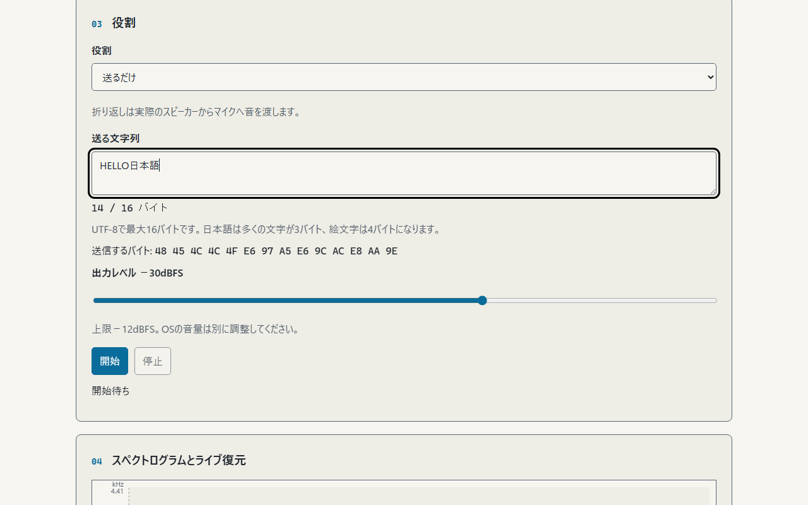
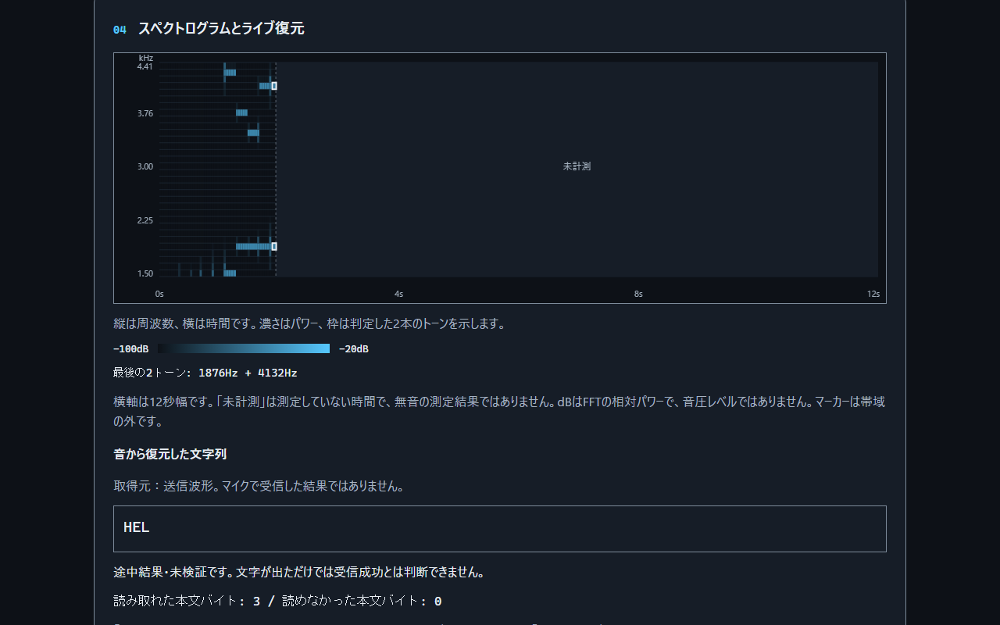
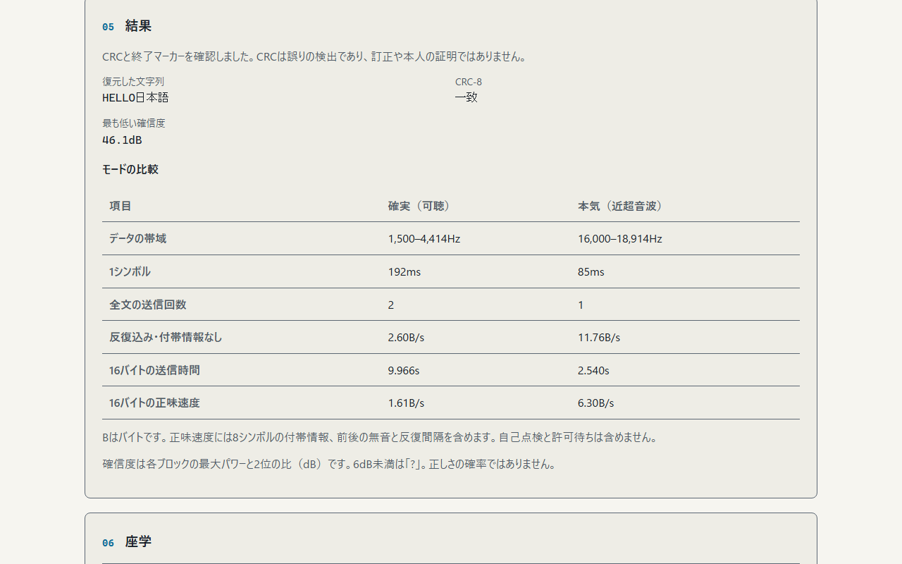
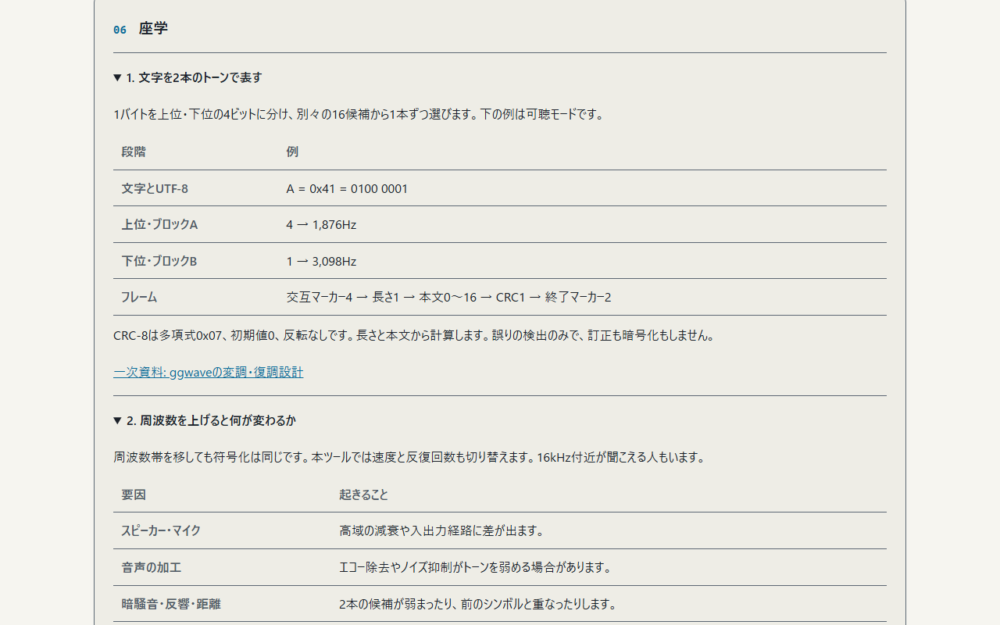

<!--
---
id: day120
slug: airborne-tone-link

title: "Airborne Tone Link"

subtitle_ja: "音で短文を送り、通信路を可視化"
subtitle_en: "Send short text through sound and visualize the channel"

description_ja: "可聴・近超音波の2トーンで最大16バイトを送受信する教材。スペクトログラム、ライブ復元、CRC-8、WAV復元で通信の成立と限界を確かめます。"
description_en: "An educational two-tone modem for up to 16 UTF-8 bytes, with audible and near-ultrasonic modes, a live spectrogram, incremental decoding, CRC-8 and local WAV decoding."

category_ja:
  - プライバシー
  - 音響監視
category_en:
  - Privacy
  - Acoustic Surveillance

difficulty: 2

tags:
  - acoustic-channel
  - mfsk
  - spectrogram
  - air-gap
  - web-audio

repo_url: "https://github.com/ipusiron/airborne-tone-link"
demo_url: "https://ipusiron.github.io/airborne-tone-link/"

hub: true
---
-->

# Airborne Tone Link - 音で短文を送り、通信路を可視化


[](https://ipusiron.github.io/airborne-tone-link/)

**Day120 - 生成AIで作るセキュリティツール200**

Airborne Tone Linkは、短い文字列をスピーカーからマイクへ渡し、その通信路をスペクトログラムで見る学習ツールです。
可聴・近超音波の両方で、文字がUTF-8のバイト、2本のトーン、受信文字列へ変わる過程を確かめられます。
暗号化はしていません。同じ方式を知る受信者は内容を復元できます。

日本語 / [English](README.en.md)

## 🌐 デモページ

👉 **[Airborne Tone Linkを開く](https://ipusiron.github.io/airborne-tone-link/)**

インストールは不要です。手元にファイル一式を置き、`index.html`を直接開く使い方もできます。
マイクの利用にはブラウザーの許可が必要です。公開HTTPSかlocalhostを推奨します。`file://`でのマイクの扱いはブラウザーによって異なります。

## 📸 スクリーンショット

> 
>
> *「HELLO日本語」を入力。14バイトとして表示します。*

> 
>
> *実際の送信波形をFFTで解析。2本のトーンの並びと、途中まで戻った文字列が見えます。*

> 
>
> *WAVから復元した結果。CRC、確信度、16バイト時の所要時間を表示します。*

> 
>
> *「A」を2本の周波数に分ける例。座学は5節あります。*

英語の4画面は[英語README](README.en.md#-screenshots)に掲載しています。

## ✨ 主な機能

- 1バイトを上位・下位4ビットに分け、別々の16候補から2本のトーンを同時に出力
- 「確実（可聴）」と「本気（近超音波）」の2モード
- 送るだけ・受けるだけ・物理的な折り返し・WAVのオフライン復元
- 32本のデータトーンを拡大したスペクトログラムと、UTF-8文字単位のライブ復元
- CRC-8、確信度、折り返し時の文字一致率
- マイクの加工状態の表示、日英切り替え、明暗切り替え、キーボード対応

## 📖 使い方

### 2台で送受信する

1. 両方の端末を開き、同じモードを選びます。最初は「確実」を使います。
2. 受信側は「受けるだけ」を選び、開始してマイクを許可します。
3. 送信側は「送るだけ」を選び、16バイト以内の短文を入力します。
4. OSの音量を小さくし、開始します。受信側の文字列とCRCを確認します。
5. 近超音波を試す場合は、両方を「本気」に変更します。

`HELLO`は5バイト、`日本語`は9バイト、`😀😀😀😀`は16バイトです。
「確実」は低速モードの名前で、成功を保証するものではありません。16kHz付近が聞こえる人もいます。
同時送信は避けてください。自動応答や再送要求はありません。方向を逆にする場合は役割を切り替えます。

### 1台で折り返す

「折り返し（1台）」はスピーカーからマイクへ実際に音を渡します。
1kHzの短い自己点検音が背景より10dB以上増えたことを確認してから、本送信を開始します。
ヘッドホンではマイクまで音が届かず、自己点検で止まる場合があります。
加工がオンなら確認ダイアログを表示します。表示は要求値ではなく、マイクが報告した実値です。

### WAVを復元する

「オフライン復元」を選び、このツールと同じフレーム形式のWAVを読み込みます。
PCM 16/24/32bit、float 32bit、8〜96kHz、1〜2チャンネル、12MiB以内、60秒以内に対応します。
ファイルのレートで選択帯域を解析できることが必要です。圧縮WAVとWAVE_FORMAT_EXTENSIBLEは対象外です。
ステレオは左右を平均するため、逆相の音は相殺されます。他方式の音声モデムや話し声は復元できません。

WAV復元はマイクも音声出力も使いません。選択したファイルは端末内だけで読み、終了・停止後に選択と解析用データを解放します。

### 復元した文字列と受信成功の違い

「音から復元した文字列」は、受けるだけ・折り返しではマイク入力、送るだけでは送信波形、オフラインではWAVから読み取った候補です。送る文字列をコピーして表示することはありません。読み取り中は未検証で、CRC・終了マーカー・UTF-8の検証結果を別に表示します。

本文を1バイトも読み取れていなければ「復元できた文字はありません」と表示します。「?」は読めなかった位置の目印で、取得した文字ではありません（元の文に含まれる「?」を除きます）。読み取れたバイト数と読めなかったバイト数を併記します。途中で停止した候補は未検証のまま残し、モード・役割の切り替え時に前回の結果を消去します。

グラフの横軸は12秒幅です。「本気」は短時間で終了するため右側に未計測の時間が残ります。「未計測」は無音の測定結果や受信失敗を意味しません。フレームを最後まで読み取れなかった場合も、途中の候補がある場合と本文を読めなかった場合を分けて確認してください。
録音や音声ダウンロードの機能はありません。

## 🎯 ユースケース

### このツールならではの使い方

| 問い | 操作と得られる例 |
|---|---|
| 文字数と通信量は同じか | `HELLO`は5文字・5バイト、`日本語`は3文字・9バイト。見かけの長さと通信時間の違いを確かめる |
| 同じ文字が続くと何が見えるか | `AAAA`では1,876Hzと3,098Hzの2本が続く。文字が変わらなくても同期時計で4バイトとして読む |
| どの周波数が欠けると読めないか | 2台で向きや距離を変え、スペクトログラムのA/B両ブロックを見る。片方だけでは4ビットが足りず「?」になる |
| 速さの数字は何を数えているか | 最大16バイトの可聴送信は9.966秒・正味1.61B/s。付帯情報を除く2.60B/sとの違いを計算する |
| 通信と秘密は同じか | 公開短文を別の受信端末でも読む。CRCの成功は暗号化や送信者の認証を意味しない |

授業や展示では、可聴モードで仕組みを説明してから近超音波へ進めます。
音響条件を分けて確認したいときは、同じフレームのWAVを使うと部屋や機材の経路を含めず復元を確認できます。

## 🔬 通信方式と判定

| 項目 | 値 |
|---|---|
| 文字コード・上限 | UTF-8、16バイト |
| トーン | ブロックAが上位4ビット、ブロックBが下位4ビット、計32候補 |
| 周波数間隔 | 94Hz。48kHz・FFT 2048で約4ビン |
| データ帯の幅 | 2,914Hz（31間隔）。専用マーカーはF0−188HzとF0−94Hz |
| フレーム | 交互マーカー4、長さ1、本文0〜16、CRC1、終了マーカー2 |
| CRC | CRC-8/SMBUS：多項式0x07、初期値0、反転なし、最終XOR 0。長さと本文を対象 |
| FFT | 2048点、Blackman窓、平滑化0、候補の最寄りビン±1の最大パワー |
| 確信度 | 最大候補と2位のパワー比。各ブロック6dB以上で採用、低い側の値を表示 |
| 出力 | 計算した正弦波のAudioBuffer、端のランプ6ms、既定−30dBFS、上限−12dBFS |

`HELLO`の本文は`48 45 4C 4C 4F`、長さは`05`、CRCは`B8`です。
`A`（`41`）は可聴モードで1,876Hzと3,098Hzになります。
プリアンブルの後は固定周期でシンボルを読むので、同じバイトが連続しても区切れます。
マーカーはデータ帯より下にあり、スペクトログラムの32本には含めません。

スペクトログラムの濃さは相対的なFFTパワー（−100〜−20dB）です。音圧レベルの測定ではありません。
最後に判定できた2本を枠でも示します。表示は直近12秒で、動きを減らす設定では描画を毎秒4回以下にします。復調の間隔は変えません。
日本語などの複数バイト文字は必要なバイトがそろってから表示します。

CRCは誤りを検出するだけで、訂正しません。終了マーカーとUTF-8の妥当性も確認します。
確信度は正解の確率ではなく、CRCの一致も完全性や本人の証明にはなりません。
折り返し時の一致率はUnicodeコードポイントを位置ごとに比較し、長い側の文字数を分母にします。
受けるだけ・WAV・送るだけでは、送信元の正解を持たないため一致率を表示しません。

### OfflineAudioContextで確定した値

ChromiumとFirefoxで44.1/48kHzの24条件を確認しました。
34周波数の出力振幅を独立した正弦・余弦の最小二乗法で測った8条件では、−30dBFSに対する最大誤差は0.000001dB未満でした。
送信44.1/48kHzと受信44.1/48kHzを組み合わせた16条件では、ネイティブのリサンプリング後の波形を独立FFTで解析し、`HELLO日本語`とCRCを復元しました。
この測定により、F0=1,500/16,000Hz、間隔94Hz、192/85msを採用しました。これはソフトウェア内の検証で、実機の高域特性や到達距離の測定ではありません。

## ⏱️ 転送速度の限界

| 項目 | 確実（可聴） | 本気（近超音波） |
|---|---:|---:|
| F0 | 1,500Hz | 16,000Hz |
| データ帯 | 1,500〜4,414Hz | 16,000〜18,914Hz |
| シンボル長 | 192ms | 85ms |
| 全文の送信回数 | 2回 | 1回 |
| 反復込み・付帯情報なし | 2.60B/s（約2.5） | 11.76B/s（約12） |
| 16バイトの送信時間 | 9.966s | 2.540s |
| 16バイトの正味速度 | 1.61B/s | 6.30B/s |

Bはバイトです。反復込み・付帯情報なしの速度は`1 / (シンボル長 × 送信回数)`です。
長さをL、シンボル長をT、送信回数をRとすると、送信波形の時間は`0.5 + (L + 8) × T × R + 0.25 × (R − 1)`秒です。
前後の無音各250msと反復間隔250msを含みます。許可待ち、自己点検、OS・機材の遅延は含みません。
「約2.5B/s」「約12B/s」をフレーム全体の実効速度と解釈すると過大になります。

本実装では、2048点の解析窓（48kHzで約42.7ms）をシンボルの安定区間に収め、94Hz間隔の候補を分けるために時間を使います。
短くすると反響や処理の遅れの影響が大きくなり、間隔を広げると必要な帯域が増えます。
暗騒音、高域の減衰、マイクの加工、端末差は受信の余裕を減らします。周波数を高くするだけで速くなるわけではありません。

[ggwaveの作者の説明](https://github.com/ggerganov/ggwave#details)では8〜16B/sです。
ggwaveは6本同時・3バイトとReed–Solomon誤り訂正を使います。本ツールは2本同時・1バイトとCRCのみで、通信互換性はありません。
ggwave/quietのコンパイル済み処理を組み込まず、通常スクリプトだけで制限の厳しいCSPと`file://`に対応しています。

## 🔄 他のエアギャップ通信との比較

以下の距離は実験室条件（直視、特定機材、最良条件など）の報告値です。最大速度と最大距離を同時に達成したという意味ではありません。
対策欄は経路を減らす考え方の要約で、単独の対策による保証ではありません。

| 経路・手法 | 帯域・受信機 | 距離・条件 | 対策の例 | 出典 |
|---|---|---|---|---|
| 音響・本ツール | 16バイト時1.61/6.30B/s、マイク | 実機で未測定 | 不要な音声入出力を切る、受信端末を管理 | 上の実装・計算値 |
| 光・LED-it-GO | 最大4000bit/s〔フォトダイオード〕、15〜120bit/s〔カメラ〕 | 光センサー室内3〜5m、夜間屋外20mの信号観測、カメラ8mの例 | LEDの遮蔽、カメラの持ち込み制限 | [著者論文](https://arxiv.org/pdf/1702.06715)、表7・距離節 |
| 磁界・MAGNETO | 0.2〜5bit/s、スマートフォンの磁力計 | 0〜12cm、デスクトップPC | 近接端末の管理、距離を取る | [著者論文](https://arxiv.org/pdf/1802.02317)、表1 |
| 磁界・ODINI | 40bit/s、専用磁気センサー | 100〜150cm | 受信機の持ち込み制限、磁界への対策 | [MAGNETO表1経由](https://arxiv.org/pdf/1802.02317)。原論文未確認 |
| 熱・BitWhisper | 1〜8bit/hour、別PCの内蔵温度センサー、双方向 | 0〜40cm | 端末間の距離、熱的な分離 | [著者論文](https://arxiv.org/abs/1503.07919) |
| 電磁・AirHopper | 13〜60B/s（104〜480bit/s）、FMラジオ付き携帯 | 1〜7m | 受信機の管理、電磁放射への対策 | [BGU研究者の紹介](https://cyber.bgu.ac.il/how-leak-sensitive-data-isolated-computer-air-gap-near-mobile-phone-airhopper/) |
| 電力・PowerHammer | line-level 1000bit/s／phase-level 10bit/s、電流プローブ | 配電線のタップ位置に依存。距離をメートルで一律に示せない | 配電設備への接近を管理、電力線の監視・フィルタリング | [著者論文](https://arxiv.org/abs/1804.04014) |

リンク先のarXivは著者公開版です。arXiv掲載だけを査読済みの根拠にはしていません。
ODINIの数値は引用経由であり、原論文の直接確認と区別します。
音響の方式同士にも差があるため、ggwaveの距離の紹介や他研究の最大距離を本ツールの到達距離として使っていません。
Arpらの2017年の超音波ビーコン研究についても、距離を確認できていない「約2m」という値は採用していません。

## 📚 エアギャップ・ブリッジとの関連

本ツールは、書籍が扱う隔離環境への入力・隔離環境からの出力という2つの方向を、音響通信で考える関連教材です。
受信側では短文が文字へ戻る過程を、送信側ではバイトがトーンへ変わる過程を実習できます。

- [『エアギャップ・ブリッジ 隔離環境のデータ入力技法』書籍情報](https://akademeia.info/?page_id=53563)
- [『エアギャップ・ブリッジ 隔離環境のデータ出力技法』書籍情報](https://akademeia.info/?page_id=53554)

書籍の最新の目次はリンク先で確認できます。書籍本文の引用・転載はしていません。

## 🔒 プライバシーと安全

- 音声の録音、送受信内容の保存、ネットワーク経由の送信は行わない。言語と明暗だけをlocalStorageへ保存
- 「送るだけ」ではマイクを開かない。受信は最長60秒。送信は有限長の波形で自動停止
- 停止、タブの非表示、ページを離れる操作、ヘルプ表示、入力のミュート・終了、音声処理の中断で停止
- ミュートが解除されても自動再開しない。開始ボタンからやり直す
- 外部スクリプト・フォント・CDNなし。入力文字はtextContentで表示
- 出力上限−12dBFSはデジタル振幅の上限であり、実際の音圧の上限ではない

GitHub Pagesでは任意のHTTPレスポンスヘッダーを設定できません。指定のmeta CSPは適用しますが、X-Frame-Optionsによる他サイトへの埋め込み防止は提供していません。

OSの音量を小さくして始め、周囲の人やペットに配慮してください。不快ならすぐ止めてください。
人に音を浴びせるための道具ではなく、医療機器でもありません。
作者IPUSIRONはセキュリティ分野の技術書の著者であり、悪用を勧めません。参加者が理解・同意できる環境で使ってください。

## 🔗 関連ツールと一次資料

- [Day119 Ultrasonic Reach Meter](https://ipusiron.github.io/ultrasonic-reach-meter/)：端末の出力から入力まで、近超音波が届く条件を調べる
- [Day041 Mic Gain Logger](https://ipusiron.github.io/mic-gain-logger/)：マイクの帯域別エネルギーを継続して見る
- [ggwave](https://github.com/ggerganov/ggwave)：4ビットの周波数割当、マーカー、誤り訂正の設計
- [Web Audio API（W3C）](https://www.w3.org/TR/webaudio-1.0/)：AudioBufferSourceNode、AnalyserNode、FFTと窓関数
- [FTCのSilverpush警告（2016年）](https://www.ftc.gov/news-events/news/press-releases/2016/03/ftc-issues-warning-letters-app-developers-using-silverpush-code)：利用者への通知に関する公的文書

Day119のパワー計算・音声処理と、Day118の1ページ構成・配色を同作者のMITコードから参考にしています。

## 🧪 テスト

Node.js 22以上で、追加パッケージなしに実行できます。

```sh
npm test
```

変換・CRC・同期・欠けたトーン・44.1/48kHzのずれ・一致率・停止と解放・WAVの不正入力・独立DFTとの比較・READMEの数値・CSP・日英辞書・配色を検査します。
CIはpushとpull_requestで構文検査とテストを実行します。
ブラウザー検証ではChromiumの模擬WAVマイクで受信し、実波形の復元、ライブ文字列、CRC、停止後の入力解放を確認しています。
折り返しの自動試験は検査用の仮想経路であり、物理的なスピーカー・マイクの実証ではありません。

## 📁 ディレクトリー構造

```text
airborne-tone-link/
├── index.html                  # 1ページの画面・5節の座学
├── style.css                   # 明暗・レスポンシブ・配色トークン
├── codec-core.js               # 符号化・同期・CRC・純粋FFT・WAV解析
├── audio-io.js                 # 音声入出力・停止・WAV復元の進行
├── messages.js                 # 日英辞書
├── app.js                      # 操作・結果・スペクトログラム
├── assets/                     # 日英4状態ずつのPNG（計8枚）
├── test/                       # node:test
│   ├── codec.test.js           # 変換・同期・判定・一致率
│   ├── audio.test.js           # 音声経路・中断・解放
│   ├── app-state.test.js       # 復元候補・未取得・検証状態・結果消去
│   ├── offline.test.js         # 独立DFT・WAV・実PCM復元
│   ├── structure.test.js       # CSP・配色・辞書・形式
│   └── readme.test.js          # メタデータ・例・速度・出典・画像
├── .github/workflows/test.yml  # pushとPRのNode 22検証
├── package.json                # 依存なしのテストコマンド
├── .gitignore                  # ローカル生成物の除外
├── .nojekyll                   # Pagesの静的配信
├── README.md                   # 日本語の説明
├── README.en.md                # 英語の説明
├── CLAUDE.md                   # 開発時に維持する規則
└── LICENSE                     # MIT License
```

## 💻 動作環境と確認範囲

Chromium・Firefoxの実時間音声処理と、Chromium・Firefox・Windows WebKitのWAV復元・表示を自動確認しています。
HTTPと`file://`、幅320・390・1280px、日英、明暗、ヘルプのフォーカス復帰を確認対象にしています。
Windows WebKitの検査用ポートには音声APIがなく、Safari実機の検証の代わりにはなりません。

2台の実機、部屋の反響、機種ごとの高域特性、Bluetooth経路、iPhone/Mac Safari、実際の音量・到達距離は未検証です。
AudioSession APIがある端末では、マイク利用時に`play-and-record`、送信時に`playback`を要求します。
各トーンの最高周波数が解析レートの0.45倍を超える場合や、解析窓が収まらない場合は、そのモードを停止します。
各端末の物理周波数は固定し、FFTビンだけを実際の解析レートから求めます。

## 📄 ライセンス

[MIT License](LICENSE)。実行時・開発時ともnpm依存パッケージはありません。

## 🛠️ このツールについて

本ツールは、「生成AIで作るセキュリティツール200」プロジェクトの一環として開発されました。
このプロジェクトでは、AIの支援を活用しながら、セキュリティに関連するさまざまなツールを100日間にわたり制作・公開していく取り組みを行っています。

プロジェクトの詳細や他のツールについては、以下のページをご覧ください。

🔗 [生成AIで作るセキュリティツール200](https://akademeia.info/?page_id=44607)
